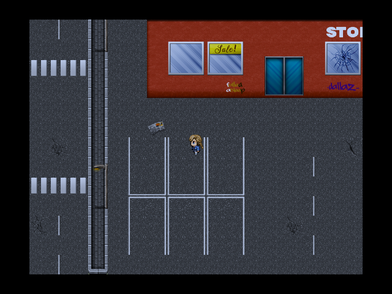
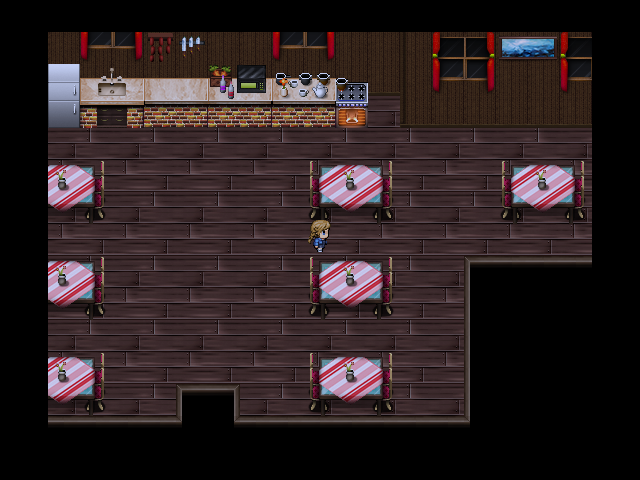
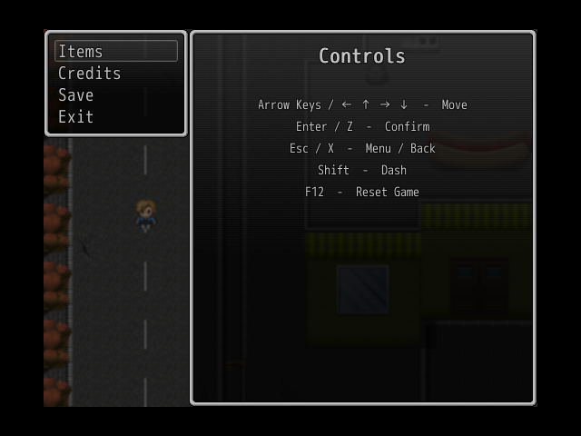

# Morrow Ridge

A 2D psychological horror and mystery game developed with **RPG Maker VX Ace**.

## 🚧 Status: Work in Progress

This game is currently in active development. A **playable Demo** will be released soon!

- **Programming:** RGSS3 (Ruby 1.9.2)
- **Engine:** RPG Maker VX Ace

---

## 📸 Gameplay Screenshots

---
